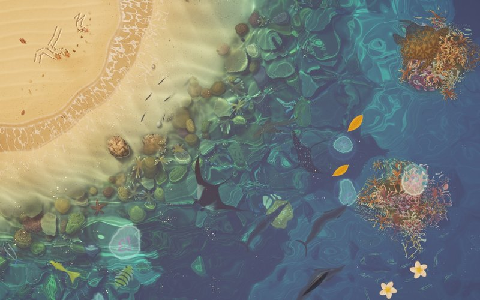
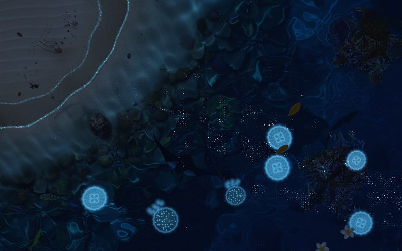
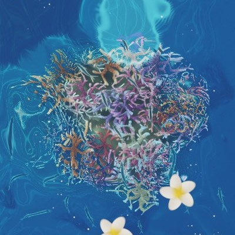
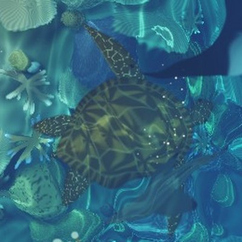
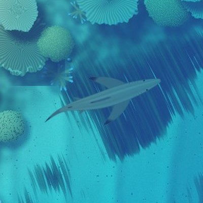
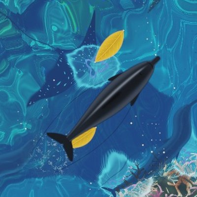
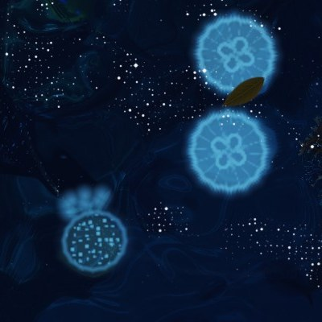

# Shallow Sea


An interactive tropical shore seen from above. Waves come in sets and wash up the beach, the water deepens from clear shallows over coral reefs and turquoise to deep blue, and fish, rays, sea turtles and jellyfish swim through it, with a pod of dolphins or a reef shark passing now and then. Everything is rendered live in WebGL2. It runs as a desktop wallpaper in [Lively Wallpaper](https://github.com/rocksdanister/lively) or Wallpaper Engine on Windows, or in any browser, phones included.

**▶ Play it in your browser: <https://lego514.github.io/shallow-sea/>** — the gear in the bottom-right corner opens the settings (English or 中文).

**▶ Watch the 43-second intro video:** [English](https://github.com/Lego514/shallow-sea/releases/download/intro-video/shallow-sea-intro-en.mp4) · [中文](https://github.com/Lego514/shallow-sea/releases/download/intro-video/shallow-sea-intro-zh.mp4) (1080p MP4, rendered from the wallpaper itself by [`tools/make_video.py`](tools/make_video.py)).

[中文說明](#中文說明)

| Morning | Sunset | Night |
| --- | --- | --- |
|  |  |  |

| Coral garden | Sea turtle | Reef shark | Dolphin leap | Jellies at night |
| --- | --- | --- | --- | --- |
|  |  |  |  |  |

## Technical highlights

- **No engine, no libraries**: about 4,000 lines of hand-written JavaScript and GLSL on plain WebGL2, organised by subject in [`src/`](src/README.md) and built into one script.
- **Water optics from physics**: refraction through the moving surface (Snell's law, n = 1.333); caustics whose brightness is 1 / |det J| of the refraction map, i.e. light conserved; per-channel Beer–Lambert absorption, so red goes first and the water turns turquoise, then blue; Fresnel reflection; sun and moon glitter from individual ripple facets.
- **Waves on the GPU**: interactive ripples solve the shallow-water wave equation, d²h/dt² = ∇·(c²∇h), with c² = (g/k)·tanh(kh) from the depth, so ripples slow, bunch up and bend toward the shore. The wind waves feel the bottom too: in the shallows each one follows ω² = gk·tanh(kh), keeps its wavenumber along the coast (Snell's law, Bouguer's on the curved coast) and swings round to face the beach, its phase integrated inward from deep water. Surf follows √(gh) wave speed, breaks according to wave height, and turns parallel to the beach as Snell's law predicts.
- **Procedural world**: every seabed, coral reef and coral garden is generated from a seed; 15+ species are drawn as animated signed-distance shapes with their own behaviour (boids schooling, breathing turtles, leaping dolphins, patrolling sharks, fish fleeing predators).
- **Performance work**: the first start after an update went from about 42 s to about 2.3 s by splitting one huge seabed shader into six small single-output passes and the creature shader into four programs, all compiled in parallel (`KHR_parallel_shader_compile`), guided by timing every program on its own with the browser's and the driver's shader caches defeated, and after finding that ANGLE on Direct3D 11 recompiles multi-render-target programs at their first draw.
- **Tested and shipped**: before the web version is published, GitHub Actions renders four fixed scenes in headless Chromium with software WebGL, with the seed, hour, random numbers and clock all pinned, and compares them pixel by pixel with reference pictures. Versioned releases for Lively Wallpaper and Wallpaper Engine; English / Chinese settings generated from one schema.

More detail in [How it works](#how-it-works), and two write-ups:

- [From 42 seconds to 2: cold-starting a WebGL wallpaper on Windows](docs/startup-time.md): finding and removing a shader-compile bottleneck through ANGLE, FXC and the GPU driver.
- [Caustics in a browser: light on the seabed from the Jacobian of refraction](docs/caustics.md): per-pixel caustics, absorption and refraction in one fragment shader.

## Install as a wallpaper

1. Install [Lively Wallpaper](https://github.com/rocksdanister/lively).
2. Download `ShallowSea-Lively.zip` from the [latest release](https://github.com/Lego514/shallow-sea/releases/latest).
3. Drag the zip into the Lively window (or use **+ Add Wallpaper** and pick the zip), then click it to apply.

Open **Customise** on the wallpaper in Lively to change the settings below.

> Lively's **Wallpaper input** setting must be **Mouse** (the default) for the wallpaper to react to your mouse.

### Wallpaper Engine

1. Download `ShallowSea-WallpaperEngine.zip` from the [latest release](https://github.com/Lego514/shallow-sea/releases/latest).
2. Extract it into `…\steamapps\common\wallpaper_engine\projects\myprojects\`, so that a `shallow-sea` folder appears there.
3. Restart Wallpaper Engine; Shallow Sea is listed under **Installed**. Its settings are in the panel on the right.

Wallpaper Engine has no buttons in its settings, so **New seabed** and **Show seabed number** are switches: flip one to make it happen. Wallpaper Engine's own frame-rate limit and pause are respected.

> The Wallpaper Engine version follows Wallpaper Engine's documented web-wallpaper API but hasn't been tried inside Wallpaper Engine yet. If something doesn't work, please [open an issue](https://github.com/Lego514/shallow-sea/issues).

## What you can do

| Action | What happens |
| --- | --- |
| Move the mouse over the water | Draws a trail of ripples; the light patterns on the seabed bend with them |
| Click | A splash with rings of light; fish scatter and floating flowers drift away |
| Press and drag | Like putting your hand in the water: bigger waves |
| Press and drag on the sand | Write or draw with your finger; the next wave smooths it away |
| Hold the mouse button still on the water | Sprinkles fish food: it floats, then slowly sinks, and the fish rush over to eat it (a stingray cleans up what reaches the bottom) |
| Hold the cursor still | Curious little fish gather around it |
| Go near a hermit crab | It pulls back into its shell, then carries on, leaving tiny footprints |
| Click right beside the dolphins | Startled, one leaps clear of the water and crashes back in with a burst of whitewater |
| At night | A path of moonlight glitters on the ripples out over the deep water. Touching the water lights up glowing plankton; jellyfish and breaking surf glow. Now and then a nest of turtle hatchlings breaks open on the beach and they scramble down to the sea, leaving tiny tracks (they freeze if you sweep the cursor over them) |
| Nothing at all | Waves arrive in sets and at an angle: the swell slows and steepens in the shallows (focusing a bright band of light on the sand), breaks into whitewater, runs up the beach and drains back in streaks of foam, leaving a foam line at the top; wet sand darkens and the churned water clouds for a moment |

## Settings

- **Time of day**: follows your clock (morning, noon, sunset and night blend into each other), or stays at one time.
- **Beach**: top left (default), top, top right, left, right, bottom, or open shallows with no beach.
- **Shallow / deep water colour**: how clear the shallows are, and the blue the deep water fades into.
- **New seabed** and **fixed seabed number**: every start makes a new seabed; to keep one you like, use its number.
- **Tides**: the sea rises and falls with real time, about every 12.4 hours, so the beach widens and narrows.
- Caustic light, wave size and speed, mouse ripples, rain, cloud shadows.
- **Corals**, small fish, big fish, rays, sea turtles (green, hawksbill, olive ridley), **dolphins**, **reef sharks**, jellyfish, hermit crabs & gulls, **turtle hatchlings**, floating flowers & leaves, **feed the fish**.
- **Wave sounds** (off by default) and **volume**: surf in step with the picture, and a plop when you tap the water.
- **Save power when idle** (on by default): after 45 seconds without the mouse it drops to 30 FPS, and is back to full speed as soon as the mouse moves.
- **Quality** and **limit to 30 FPS**: turn these down on a slow graphics card or on battery. It never draws more than 60 FPS, even on a high-refresh screen. On a 2560×1600 laptop at 30 FPS it uses about 38% of an Intel Arc 140T at native resolution, about 25% at 75% and about 18% at 50%.

Lively itself can pause the wallpaper entirely: in Lively's **Settings → Performance**, choose what happens while a fullscreen app runs, while another app has focus, and on battery.

## Files

```
shallow-sea/
  index.html             entry point used by Lively
  web.html               the web version: the same scene plus a settings panel (English / 中文)
  sea.js                 all of the simulation and shaders, built from src/ (one script, so it loads straight from disk)
  LivelyInfo.json        wallpaper info for Lively
  LivelyProperties.json  Lively's Customise panel (the web settings panel reads it too)
  project.json           the same settings for Wallpaper Engine (run `python tools/make_project_json.py` after changing LivelyProperties.json)
  thumbnail.jpg / preview.jpg / preview.gif / preview.webp   pictures for Lively and this README
src/                          the source of sea.js, by subject (see src/README.md)
  shaders/                    GLSL: the seabed passes, ripples, sprites (one file per group of creatures), the final image
  creatures/                  spawning and behaviour: fish, rays, turtles, jellies, dolphins, sharks, hatchlings
tools/build.py                joins src/ into shallow-sea/sea.js; `--check` fails if sea.js is out of date
tools/render_test.py          renders four fixed scenes and compares them with tests/render/ (see src/README.md)
tools/make_video.py           renders the intro video: scripted shots with a cursor and captions, in English and Chinese
tests/render/                 the render test's reference pictures
docs/                         the screenshots in this README, and the write-ups
.github/workflows/pages.yml   on every push to main: checks the build, runs the render test, then publishes the web version to GitHub Pages
```

To package the wallpaper yourself, zip `index.html`, `sea.js`, `LivelyInfo.json`, `LivelyProperties.json`, `thumbnail.jpg`, `preview.jpg` and `preview.gif` from `shallow-sea/` with the files at the top level of the zip.

## Run it locally

After changing anything in `src/`, rebuild `sea.js`:

```bash
python tools/build.py
```

Then serve the folder:

```bash
python -m http.server 8765 --directory shallow-sea
```

Open `http://localhost:8765/` (wallpaper version) or `http://localhost:8765/web.html` (web version). URL parameters: `?hour=21` (time of day), `?seed=123` (fixed seabed), `?shore=3` (beach position, 0–6), `?tide=0.05` (tide level), `?debug` (FPS counter), `?view=1` (caustics only), `?view=2` (seabed only), `?view=3` (depth map).

## How it works

- **Seabed**: generated procedurally (beach, sand ripples, seagrass, rocks, pebbles, shells, starfish) and baked into a texture once per seabed; the alpha channel holds water depth, negative on the beach. It is drawn in six small passes (relief, sand and seagrass, boulders, coral reefs, coral gardens and the water depth, pebbles and starfish) rather than one huge shader, and every shader program is compiled in parallel, so even the first start after an update takes only a few seconds. Light is absorbed with depth, red first, so the water shades from clear to turquoise to the scattered blue of deep water.
- **Waves on the beach**: the coastline is baked into a coordinate map. Each wave has its own size (they come in sets), arrival time and angle, and every pixel tracks the latest four: the swell travels at √depth, breaks where its height says it should, slows as it runs up the sand and speeds up as it drains. From that the shader works out whether the sand is covered, how thick and how old the foam is, and how wet the sand is. The swell's curvature also feeds the caustics.
- **Water surface**: ten analytic wind waves plus a GPU height-field simulation for the ripples made by the mouse, rain, fish and floating things. The ripples follow the shallow-water wave equation with the speed set by the water depth (c² = (g/k)·tanh(kh), so c = √(gh) in the shallows): they slow down, bunch up and steepen toward the beach, bend around the shallows and partly reflect off them, and keep their full speed in deep water. The wind waves are plane waves out in deep water; within reach of the shore each keeps its frequency while its wavenumber follows the dispersion relation for the depth, its wavenumber along the coast is kept (k_t·r around the round coast), so its crests turn to face the beach, and it grows taller as it slows. Its phase is the deep-water phase where it crossed into the shallows plus ∫ k_n ds from there in, tabulated per wave whenever the seabed is built; a wave that comes in too steeply along the coast meets a turning point and dies away.
- **Caustics**: for each point on the seabed the shader finds which surface point refracted the sunlight there; brightness is 1 / |det| of the refraction map's Jacobian, so your ripples cast matching rings of light on the sand.
- **Sparkles**: every few pixels of water hold one tiny ripple facet that takes a new tilt every half second or so. When that tilt, on top of the wave it rides, mirrors the sun (or, at night, the moon along its path) toward the eye, it flashes up and fades as a sharp point, the brightest with a small cross of glare. At dawn and sunset the sand, foam and sparkles turn golden while the deep water stays blue.
- **Coral reefs**: in patches at middle depths a bed of coral rubble is crowded with brain, table, staghorn, boulder and cauliflower corals, each casting a shadow and raising the seabed so the light patterns and ripples follow them. Out in the deep water a coral garden now and then crowds a mound that rises toward the light: antler-branched staghorns, fine bushy and fluffy colonies and lacy sea fans in orange, pink, lilac and white, each drawn as branches forking outward to pale growing tips, the taller ones overlapping the lower. They are drawn into the seabed once, when it is built.
- **Sea life**: small silver-flanked fish school as boids (flashing as they turn), big fish roam alone (a yellow tang, a sergeant major, a bluefin trevally), a blue-spotted stingray rests on the shallow sand, an eagle ray and a manta fly through the water, green, hawksbill and olive ridley turtles drift by and surface to breathe (each arrival may be a different species: the hawksbill with its tortoiseshell and serrated shell, the small, round, plain olive ridley), every few minutes a pod of bottlenose dolphins crosses the deep water in formation (each one rising to breathe in turn, now and then one leaping clear of the water and crashing back in, scattering the fish), now and then a blacktip reef shark (sometimes two) patrols the reef edge, its body sweeping side to side, while the fish keep well clear and a splash sends it off, moon jellies (four lilac horseshoe gonads) and spotted lagoon jellies (round blue or golden domes dusted with white spots, short club-tipped arms trailing behind) pulse along in deeper water, and at night their spots, rims and clubs glow. All are drawn as signed-distance shapes and cast shadows along the refracted sun direction.

## License

[MIT](LICENSE) — free to use, change and share; keep the copyright notice.

---

## 中文說明

從正上方看下去的一段熱帶海岸：浪一組一組沖上沙灘，海水從清澈的淺水、珊瑚礁、土耳其藍漸層到深藍色；魚群、魟魚、海龜（綠蠵龜、玳瑁、欖蠵龜）和水母在裡面游，偶爾還有一群海豚經過（有時會躍出水面），或一隻黑鰭礁鯊沿著珊瑚礁巡游。全部用 WebGL2 即時運算，可以當 Windows 上 [Lively Wallpaper](https://github.com/rocksdanister/lively) 或 Wallpaper Engine 的桌布，也可以直接在瀏覽器（含手機）玩。

**技術重點**：沒有用任何引擎或函式庫，約 4,000 行手寫的 JavaScript 與 GLSL 直接用 WebGL2，原始碼依主題放在 [`src/`](src/README.md)，再合併成一支程式。水的光學照物理算（Snell 折射、以折射映射 Jacobian 行列式計算的焦散、Beer–Lambert 分色吸收、Fresnel 反射、水面微面元反光）；漣漪在 GPU 上解淺水波方程，波速隨水深變化（c = √(gh)）；海床、珊瑚礁和十幾種生物全部程序化生成。遠方的風浪也會感受水深：在淺水變慢、變短、變高，並轉向與海岸平行。逐一量測每個著色器的編譯時間找出瓶頸，把一個巨大的海床著色器拆成六段、生物著色器拆成四個，全部平行編譯後，更新後第一次啟動從約 42 秒縮短到約 2.3 秒。每次推送時，GitHub Actions 會先用無頭 Chromium 和軟體 WebGL 畫出四個固定的場景（海床、時間、隨機數和時鐘全部固定），逐像素和參考圖比對，通過了才發布網頁版。

**技術文章**：

- [從 42 秒到 2 秒：在 Windows 上讓 WebGL 桌布快速冷啟動](docs/startup-time.zh-TW.md)：一路追過 ANGLE、FXC 和顯示卡驅動，找出並拿掉著色器編譯的瓶頸。
- [在瀏覽器裡畫出水底光紋：用折射的 Jacobian 算出海床上的光](docs/caustics.zh-TW.md)：在一個片段著色器裡逐像素算出焦散、吸收和折射。

**線上玩：<https://lego514.github.io/shallow-sea/>**（右下角齒輪可以調設定、切換中文／English）

**▶ 43 秒介紹影片：**[中文](https://github.com/Lego514/shallow-sea/releases/download/intro-video/shallow-sea-intro-zh.mp4) · [English](https://github.com/Lego514/shallow-sea/releases/download/intro-video/shallow-sea-intro-en.mp4)（1080p MP4，用 [`tools/make_video.py`](tools/make_video.py) 直接從桌布畫出來）

### 安裝成桌布

1. 安裝 [Lively Wallpaper](https://github.com/rocksdanister/lively)。
2. 到 [Releases](https://github.com/Lego514/shallow-sea/releases/latest) 下載 `ShallowSea-Lively.zip`。
3. 把 zip 拖進 Lively 視窗（或按「＋ 新增桌布」選這個 zip），再點它套用。

在 Lively 的桌布上按「自訂」可以調整設定。Lively 設定裡的「桌布輸入」要是「滑鼠」（預設就是），桌布才收得到滑鼠。

**Wallpaper Engine**：到 Releases 下載 `ShallowSea-WallpaperEngine.zip`，解壓到 `…\steamapps\common\wallpaper_engine\projects\myprojects\`（會多一個 `shallow-sea` 資料夾），重開 Wallpaper Engine 後在「已安裝」裡就找得到。Wallpaper Engine 的設定沒有按鈕，所以「換一片海床」「顯示海床編號」是開關，切換一次就會執行。這個版本是照 Wallpaper Engine 的官方文件做的，還沒在 Wallpaper Engine 裡實際測過，有問題歡迎開 issue。

### 互動

| 動作 | 效果 |
| --- | --- |
| 滑鼠劃過水面 | 拖出一道漣漪，海床上的光紋跟著扭動 |
| 點一下 | 濺起水花、一圈圈擴散的光環；魚會四散，漂浮的花葉被推開 |
| 按住拖曳 | 像把手伸進水裡，水波更大 |
| 在沙灘上按住拖曳 | 用手指在沙上寫字、畫圖；浪沖上來時會把它抹平 |
| 在水面上按住滑鼠不動 | 撒飼料：先浮在水面，再慢慢沉下去，魚會衝過來搶食（沉到底的會被藍點魟吃掉） |
| 游標停著不動幾秒 | 好奇的小魚會慢慢游過來繞著游標 |
| 靠近寄居蟹 | 牠會縮進殼裡，過幾秒才探出頭繼續爬，沿路留下小腳印 |
| 在海豚旁邊點一下 | 受驚的海豚會躍出水面，再「啪」一聲濺起白浪落回水裡 |
| 晚上 | 深水區的海面上有一條閃爍的月光路。碰到海水的地方會亮起藍色螢光浮游生物；水母和浪花也會發光。偶爾沙灘上會有一窩小海龜孵化，一路爬向大海、留下小小的爬痕（游標掃過時牠們會停住不動） |
| 什麼都不做 | 浪一組一組、斜斜地打進來：湧浪在淺水裡變慢變陡，碎成白浪沖上沙灘，再拖著泡沫條紋退回去，最高處留下一道泡沫線 |

### 設定

- **時段**：自動跟系統時鐘，或固定一個時段
- **沙灘位置**：左上角（預設）、上方、右上角、左側、右側、下方，或沒有沙灘的整片淺海
- **淺水顏色／深海顏色**
- **重新產生海床／固定海床編號**：每次啟動都是新的一片；喜歡現在這片就把編號填進去
- **潮汐**：照真實時間大約每 12.4 小時漲退一次
- 光紋強度、波浪大小／速度、滑鼠漣漪強度、雨、雲影
- **珊瑚**、小魚數量、大魚、魟魚、海龜（三種）、**海豚**、水母數量、寄居蟹與海鷗、**小海龜孵化**、漂浮的花與葉、**餵魚**
- **海浪聲**（預設關閉）與**音量**
- **閒置時省電**（預設開）：滑鼠 45 秒沒動就降到 30 FPS，一動馬上恢復
- **畫質／鎖定 30 FPS**：顯示卡較弱或用電池時可以調低。不論螢幕更新率多高，最多只畫 60 FPS。在 2560×1600 筆電、30 FPS 下，原生解析度約佔 Intel Arc 140T 的 38%，75% 約 25%，50% 約 18%

Lively 本身也能讓桌布完全暫停：在 Lively 的「設定 → 效能」可以設定有全螢幕程式、其他程式在前景、用電池時要不要暫停。

### 授權

[MIT](LICENSE)：可以自由使用、修改、分享，保留版權聲明即可。
