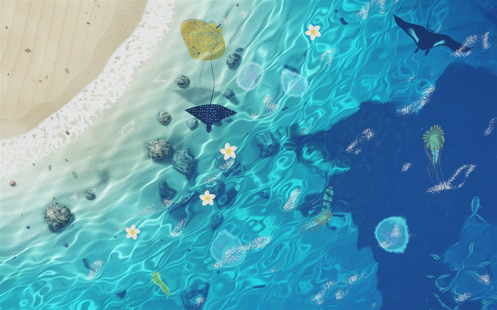

# 淺海 Shallow Sea — 互動桌布



從正上方看下去的一段熱帶海岸：沙灘、清澈的淺水，漸層到深藍色的海。用 WebGL2 即時運算，給 [Lively Wallpaper](https://github.com/rocksdanister/lively) 用的網頁桌布，也有可以直接在瀏覽器（含手機）玩的網頁版。

**線上玩：<https://lego514.github.io/shallow-sea/>**（右下角齒輪可以調設定、切換中文／English）

*An interactive tropical-shore wallpaper seen from above — waves washing up the beach, caustics, fish, rays, turtles and jellyfish, all rendered live in WebGL2. Runs as a [Lively Wallpaper](https://github.com/rocksdanister/lively) on Windows, or in any browser at the link above (settings panel in English or Chinese).*

## 安裝成桌布

1. 安裝 [Lively Wallpaper](https://github.com/rocksdanister/lively)。
2. 到這個 repo 的 [Releases](https://github.com/Lego514/shallow-sea/releases/latest) 下載 `ShallowSea-Lively.zip`。
3. 把 zip 拖進 Lively 視窗（或在 Lively 按「＋ 新增桌布」選這個 zip），再點它套用。

在 Lively 的桌布上按「自訂」可以調整下面的設定。

> Lively 設定裡的「桌布輸入」要是「滑鼠」（預設就是），桌布才收得到滑鼠。

## 互動

| 動作 | 效果 |
| --- | --- |
| 滑鼠劃過水面 | 拖出一道漣漪，波紋會讓海床上的光紋跟著扭動 |
| 按住拖曳 | 像把手伸進水裡，水波更大 |
| 點一下 | 濺起水花、一圈圈擴散的光環；魚會四散，漂浮的花葉被推開 |
| 在沙灘上按住拖曳 | 用手指在沙上寫字、畫圖；浪沖上來時會把它抹平 |
| 什麼都不做 | 浪一組一組、斜斜地打進來：湧浪在淺水裡變慢變陡（底下的沙會被聚成一道亮光），碎成白浪沖上沙灘，再拖著泡沫條紋退回去，最高處留下一道泡沫線；沙被打濕變深色，水裡的沙被攪起來一下子變混 |
| 游標停著不動幾秒 | 好奇的小魚會慢慢游過來繞著游標 |
| 靠近寄居蟹 | 牠會縮進殼裡，過幾秒才探出頭繼續爬（沿路留下小腳印） |
| 晚上（或選「夜晚」） | 碰到海水的地方會亮起藍色螢光浮游生物 |

## 設定（Lively「自訂」面板）

- **時段**：自動跟系統時鐘（清晨、正午、黃昏、夜晚之間平滑變化），或固定一個時段
- **固定海床**：按「顯示目前海床編號」，右上角會出現數字，填進「固定海床編號」就會一直是這片；留空＝每次隨機
- **潮汐**：照真實時間大約每 12.4 小時漲退一次，沙灘跟著變寬變窄
- **海龜**、**寄居蟹與海鷗**：可以個別關掉
- **海浪聲**（預設關閉）與**音量**：浪碎、沖上沙灘、退回的聲音跟畫面同步，點水面有「噗通」聲
- **沙灘位置**：左上角（預設）、上方、右上角、左側、右側、下方，或沒有沙灘的整片淺海
- **淺水顏色 / 深海顏色**：淺水是每一單位深度的透光顏色；深海是很深的地方最後變成的顏色
- **重新產生海床**：每次啟動都是新的一片海床，這個按鈕可以立刻換一片
- 光紋強度、波浪大小/速度、滑鼠漣漪強度、雨、雲影
- 小魚數量、大魚、魟魚、水母數量、漂浮的花與葉
- **畫質 / 鎖定 30 FPS**：筆電用電池時可以調低省電

## 檔案

```
shallow-sea/
  index.html             入口（Lively 用）
  web.html               網頁版：同一個場景加上右下角的設定面板（中文／English）
  sea.js                 全部的模擬與著色器
  LivelyInfo.json        Lively 桌布資訊
  LivelyProperties.json  Lively 自訂面板（網頁版的設定面板也是讀這份）
  thumbnail.jpg / preview.jpg
.github/workflows/pages.yml   推上 main 時自動把網頁版發布到 GitHub Pages
```

打包 Lively 用的 zip：把 `shallow-sea/` 裡的 `index.html`、`sea.js`、`LivelyInfo.json`、`LivelyProperties.json`、`thumbnail.jpg`、`preview.jpg` 壓成一個 zip（檔案放在 zip 最上層）。

## 在瀏覽器裡預覽

```bash
python -m http.server 8765 --directory shallow-sea
```

開 `http://localhost:8765/`（桌布版）或 `http://localhost:8765/web.html`（網頁版）。網址參數：`?hour=21`（指定時刻）、`?seed=123`（固定海床）、`?shore=3`（沙灘位置，0–6）、`?debug`（顯示 FPS）、`?view=1`（只看光紋）、`?view=2`（只看海床）、`?view=3`（水深圖）。

## 原理簡述

- **海床**：程序生成（沙灘、沙紋、海草、礁石、卵石、貝殼、海星），只在啟動或換海床時烘焙一次成貼圖，alpha 存水深（沙灘上是負的）。水深從岸邊一路變深，海水顏色依水深吸收光線（紅光最先被吃掉），深處變成散射的深藍。
- **海浪**：海岸線烘焙成一張座標圖。每道浪有自己的大小（成組出現）、到達時間和斜角；每個像素同時追蹤最近四道浪：湧浪以 √水深 的速度前進、在依浪高決定的位置碎掉、沖上沙灘時減速、退回時加速。依這些算出水有沒有蓋過沙、泡沫多濃多老、沙有多濕；湧浪的曲率也算進光紋裡。
- **水面**：10 道解析式風浪 ＋ GPU 高度場波動模擬（滑鼠、雨滴、魚和漂浮物激起的漣漪）。
- **光紋**：對每個海床點反解是哪個水面點折射過來的陽光，亮度 = 1 / |折射映射的 Jacobian 行列式|，所以滑鼠激起的漣漪也會在海底投出對應的光環。
- **生物**：小魚是 boids 魚群，大魚獨自巡游；藍點魟趴在淺水沙地上，斑點鷹魟和鬼蝠魟在水中拍翅膀游；月亮水母和金黃水母（海蕁麻）在較深的水裡一縮一放地漂。全部用 SDF 畫，影子沿折射後的太陽方向投在海床上。
