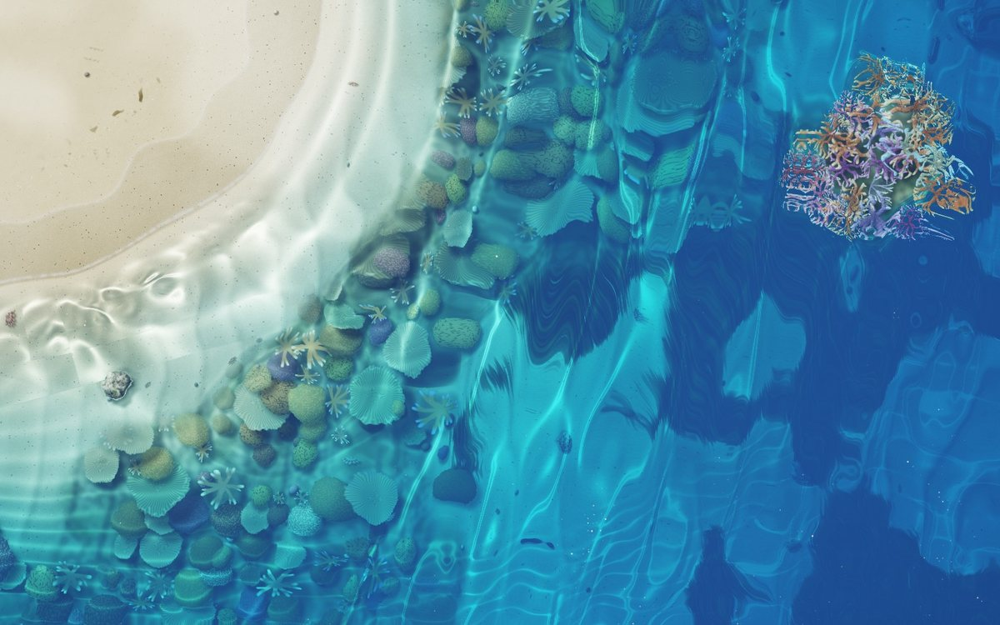
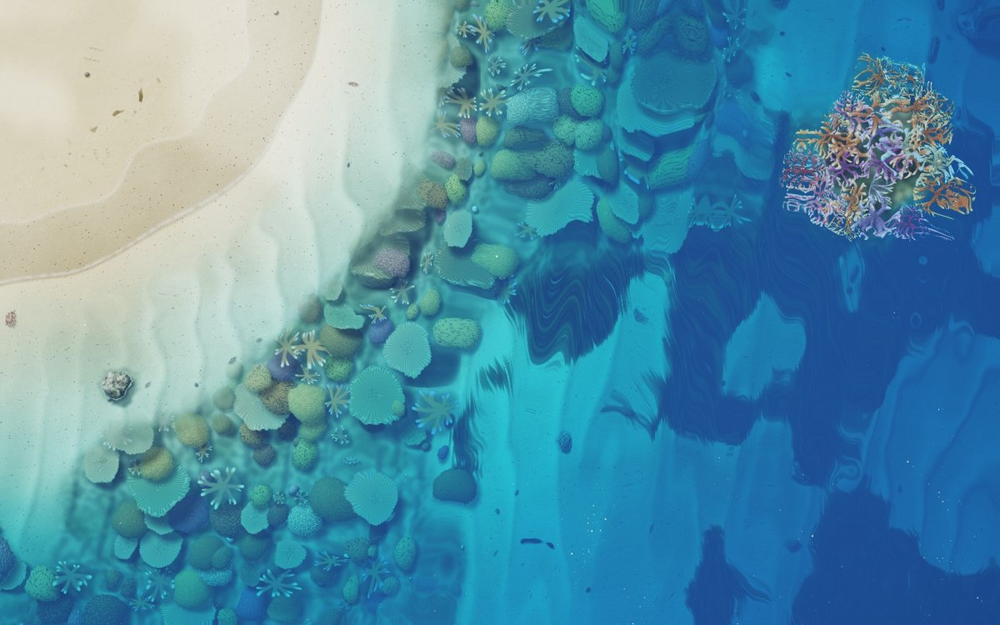
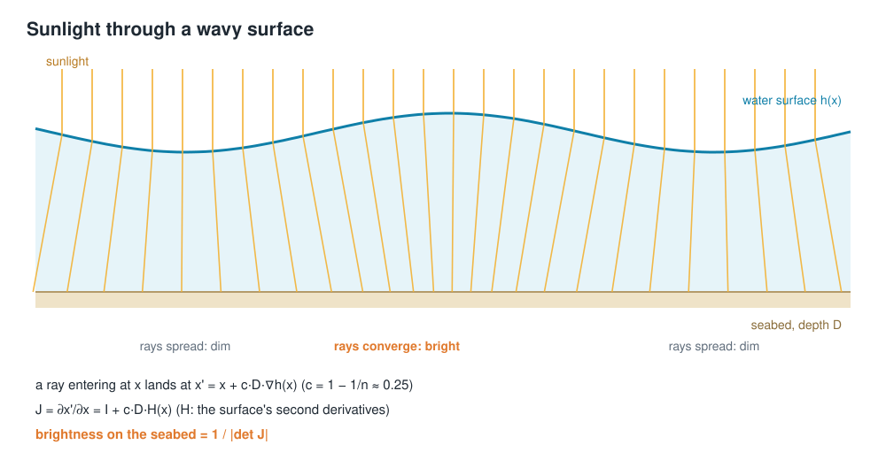
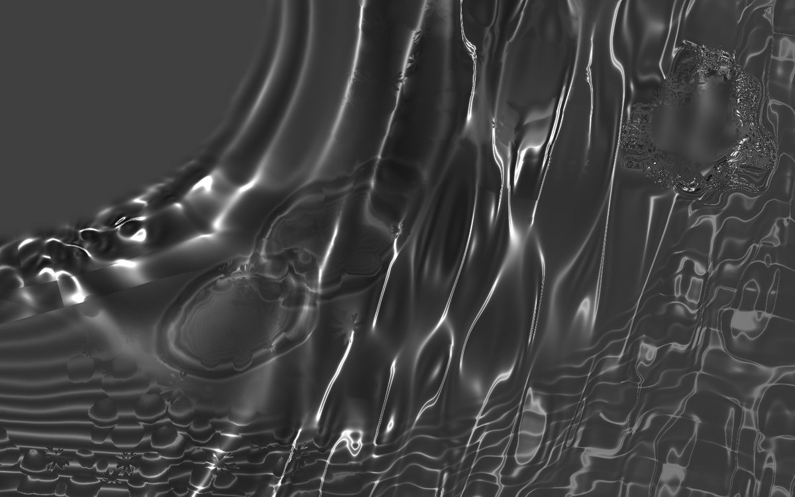
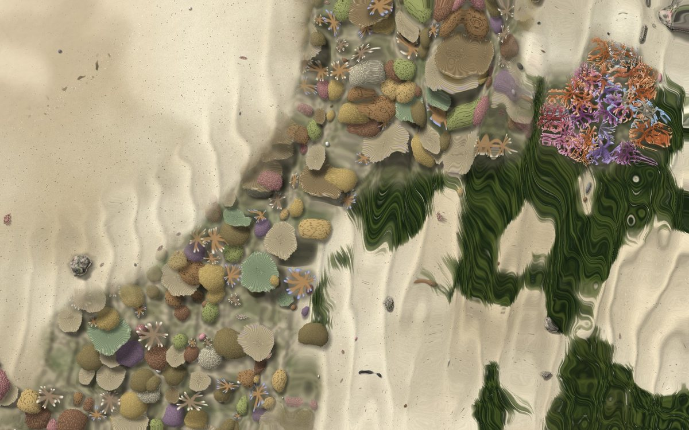
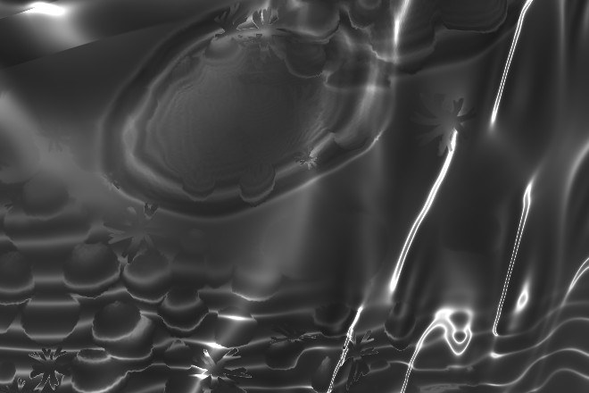

# Caustics in a browser: light on the seabed from the Jacobian of refraction

[中文版](caustics.zh-TW.md) · [Shallow Sea](../README.md)

The ribbons of light that wobble across the bottom of shallow water are *caustics*. In Shallow Sea they come from the same waves you see on the surface, they react to every ripple you make with the mouse, and they cost no extra render pass. This is how they are computed, one pixel at a time, in the final fragment shader.

| With caustics | Without |
| --- | --- |
|  |  |

## Where caustics come from

The water surface is a moving sheet of lenses. Where it bulges up into a crest, the sunlight under it is bent inward and lands on a smaller patch of the seabed, so that patch is brighter. Under a trough the light spreads out and the seabed is dimmer. No light is created or lost; it is only moved around.



## The usual way, and the way used here

The classic way to draw caustics, used for example in Evan Wallace's *WebGL Water*, works forward from the sun. You send a grid of rays down through the surface, see where each lands, and measure how much each grid cell has shrunk or grown. That needs an extra pass and a mesh, and the result is only as fine as the grid.

Shallow Sea works backwards instead. For each seabed pixel it asks how concentrated the light arriving here is. That turns out to be a small, local calculation.

## The formula

Take a surface with height *h(x)* above water of depth *D*. For small slopes, Snell's law tilts a vertical ray entering at *x* by about (1 − 1/n)·∇h, with n ≈ 1.33 for water, so it lands at

> x′ = x + c · D · ∇h(x),  with c = 1 − 1/n ≈ 0.25.

That is a map from surface points to seabed points. Light conservation says the brightness on the seabed is the incoming brightness divided by how much a small patch of area grows under the map, which is the determinant of its Jacobian:

> J = ∂x′/∂x = I + c · D · H(x),  where H is the surface's matrix of second derivatives,
>
> brightness = 1 / |det J|.

Where the surface curves down (a crest), *H* is negative, det J drops below 1, and the light concentrates. Where it curves up (a trough), det J grows and the light spreads. When det J reaches 0 the rays cross and you get the bright focal lines.

## Doing it backwards, per pixel

The shader draws seabed point x′ and needs the surface point *x* whose ray landed there. That is x = x′ − c·D·∇h(x), an equation in *x*, and two fixed-point steps starting from x′ are enough at these slopes. The sun is rarely straight overhead, so x′ is first shifted along the refracted sun direction by the depth. Lightly simplified from the shader:

```glsl
// caustics: find the surface point whose refracted sun ray lands here,
// brightness = 1 / |det| of the refraction map Jacobian at that point
float cd = CR * min(D, 0.9);
vec2 x0 = pf - u_sunShift * D;
vec2 xs = x0;
for (int i = 0; i < 2; i++) xs = x0 - cd * (ambGrad(xs) + simGrad(toUV(xs)));
vec3 Hm = ambHess(xs) + simHess(toUV(xs)) + swellCurvature;   // (hxx, hyy, hxy)
float det = (1.0 + cd * Hm.x) * (1.0 + cd * Hm.y) - cd * cd * Hm.z * Hm.z;
float I = mix(1.0, inversesqrt(det * det + 0.025), strength);
```

## Three surfaces in one Hessian

The surface's slope and curvature come from three sources, which simply add:

- **Wind waves**: ten analytic sine waves. Their gradient and second derivatives are exact and cheap.
- **Ripples**: the ones you make, plus rain, fish and floating things, come from a height field simulated on the GPU. There the gradient and Hessian are finite differences of neighbouring texels.
- **The swell coming ashore**: the breaking-wave model provides a curvature along the shore normal. That is what draws the bright band of light that runs up the sand ahead of each wave.

Because the ripple simulation feeds the same Hessian, a click on the water makes rings of light on the seabed that move exactly with the rings on the surface.



## Taming the infinities

At a focus det J is zero and the brightness formula blows up. `inversesqrt(det² + 0.025)` instead caps the peak at about 6× and keeps the falloff smooth, which also hides the aliasing a true singularity would cause. The effect is faded out with depth, because in deep water the patterns blur into an even glow. It is also faded on the dry sand.

## Light through water

Caustics only decide how much sunlight arrives. The colour of the water comes from absorption, using the Beer–Lambert law per colour channel:

```glsl
vec3 Tdown = exp(-sigma * D * pathK);    // sunlight going down (a slanted path is longer)
vec3 Tup   = exp(-sigma * D);            // light coming back up to the eye
vec3 col   = albedo * (sun * Tdown * I + ambient * Tup) * Tup;
col += deepColour * (1.0 - exp(-D * 1.4));   // light scattered back by the water itself
```

The absorption coefficients σ come from the "shallow water colour" setting (σ = −ln of each channel). Water swallows red first, then green, so the same white sand turns turquoise in a metre of water and blue further out:

| The seabed's own colours | After absorption (no caustics) |
| --- | --- |
|  |  |

## The eye looks through the surface too

The same small-slope refraction moves what you see. The seabed is sampled at p + c·D·∇h(p) rather than at p, so the sand, coral and creatures wobble under every wave and ripple, while the caustics sit on them in the right place.



## Cost and limits

Per pixel, the caustics take three evaluations of the surface slope and one of its curvature, plus a handful of texture reads for the ripples. There is no extra pass, mesh or texture. Later, the wind waves were made to feel the bottom (they slow down, shorten and turn toward the shore in shallow water). Each wave's local values are then worked out once per pixel and reused for these nearby lookups, so the frame cost didn't change.

The method has known approximations:

- **One source point.** Where several surface points send light to the same seabed point, near the cusps of a caustic, the fixed-point iteration finds only one of them, so the brightest crossings are approximate.
- **Small slopes.** The linearised Snell's law is accurate for gentle waves, not for breaking ones; the surf zone is drawn by a separate model.
- **No dispersion.** Real caustics show faint colour fringes; these are white light, tinted only by the absorption.

The code is in [`src/shaders/composite.js`](../src/shaders/composite.js) (`ambGrad`, `ambHess`, `simHess` and the caustics block in `main`).
