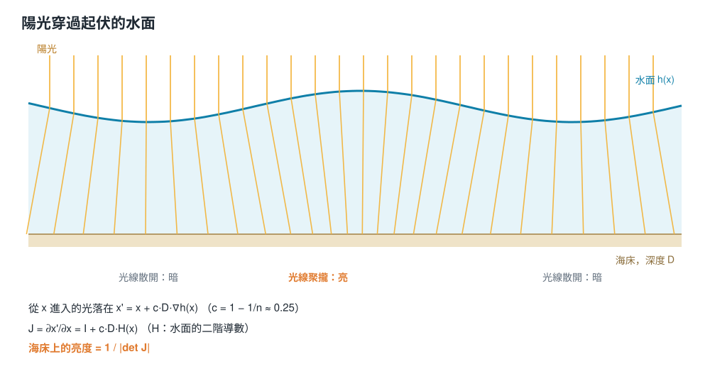

# 在瀏覽器裡畫出水底光紋：用折射的 Jacobian 算出海床上的光

[English](caustics.md) · [Shallow Sea](../README.md)

淺水底下那些晃動的光帶叫做**焦散（caustics）**。在 Shallow Sea 裡，它們來自水面上看得到的同一組浪，會對你用滑鼠弄出的每一道漣漪起反應，而且不需要額外的繪製階段。這篇說明它們怎麼在最後一個片段著色器裡，一個像素一個像素算出來。

| 有焦散 | 沒有焦散 |
| --- | --- |
|  |  |

## 焦散從哪裡來

水面是一片會動的透鏡。水面隆起成浪峰的地方，底下的陽光被往內折，落在海床上比較小的一塊，所以那裡比較亮；浪谷底下的光則被散開，海床比較暗。光沒有變多也沒有變少，只是被搬了位置。



## 一般的做法，和這裡的做法

畫焦散的經典做法（例如 Evan Wallace 的 *WebGL Water*）是從太陽往下算：把一整片格子狀的光線射過水面，看每條落在哪裡，再量每個格子縮小或變大了多少。這需要額外一個繪製階段和一張網格，而且結果只能跟格子一樣細。

Shallow Sea 反過來做：對海床上的每個像素，直接問「照到這裡的光有多集中？」結果這是一個很小、只看附近的計算。

## 公式

假設水面高度是 *h(x)*，底下的水深是 *D*。在坡度小的時候，Snell 定律會讓從 *x* 垂直進入的光線偏轉約 (1 − 1/n)·∇h（水的 n ≈ 1.33），所以它落在：

> x′ = x + c · D · ∇h(x)，其中 c = 1 − 1/n ≈ 0.25。

這是一個從水面點到海床點的映射。光的守恆告訴我們：海床上的亮度，等於進來的亮度除以一小塊面積經過這個映射後放大的倍數，也就是它 Jacobian 的行列式：

> J = ∂x′/∂x = I + c · D · H(x)，H 是水面的二階導數矩陣，
>
> 亮度 = 1 / |det J|。

水面往下彎的地方（浪峰），*H* 是負的，det J 小於 1，光被聚集；往上彎的地方（浪谷），det J 變大，光被散開。det J 到 0 時光線交叉，就出現最亮的焦線。

## 反過來、逐像素地算

著色器畫的是海床上的點 x′，需要的是「哪個水面點 *x* 的光線落在這裡」。也就是解 x = x′ − c·D·∇h(x)。這是一個關於 *x* 的方程式，以這裡的坡度，從 x′ 出發做兩次不動點迭代就夠了。太陽很少剛好在正上方，所以 x′ 會先沿著折射後的陽光方向，依水深移動一段。以下是稍微簡化過的著色器程式：

```glsl
// 焦散：找出折射後的陽光落在這裡的那個水面點，
// 亮度 = 那一點上折射映射 Jacobian 行列式的倒數
float cd = CR * min(D, 0.9);
vec2 x0 = pf - u_sunShift * D;
vec2 xs = x0;
for (int i = 0; i < 2; i++) xs = x0 - cd * (ambGrad(xs) + simGrad(toUV(xs)));
vec3 Hm = ambHess(xs) + simHess(toUV(xs)) + swellCurvature;   // (hxx, hyy, hxy)
float det = (1.0 + cd * Hm.x) * (1.0 + cd * Hm.y) - cd * cd * Hm.z * Hm.z;
float I = mix(1.0, inversesqrt(det * det + 0.025), strength);
```

## 三種水面，加進同一個 Hessian

水面的坡度和曲率來自三個來源，直接相加：

- **風浪**：十個解析的正弦波，梯度和二階導數都能精確又便宜地算出來。
- **漣漪**：你弄出來的、雨滴、魚和漂浮物造成的漣漪，來自 GPU 上模擬的高度場；梯度和 Hessian 用相鄰像素的有限差分算。
- **沖上岸的湧浪**：碎浪模型提供沿著海岸法線方向的曲率，就是它畫出每道浪前面那條跑上沙灘的亮帶。

因為漣漪模擬也加進同一個 Hessian，在水面點一下，海床上就會出現跟水面漣漪完全同步移動的光環。


## 馴服無限大

在焦點上 det J 等於 0，亮度公式會爆掉。改用 `inversesqrt(det² + 0.025)`，把最高亮度限制在約 6 倍，衰減也保持平滑，同時藏住真正的奇點會造成的鋸齒。效果會隨水深淡出，因為在深水裡光紋會糊成均勻的光；在乾沙上也會淡掉。

## 光穿過水

焦散只決定有多少陽光到達海床；水的顏色來自吸收，用 Beer–Lambert 定律對每個顏色分別計算：

```glsl
vec3 Tdown = exp(-sigma * D * pathK);    // 往下照的陽光（斜射時路徑比較長）
vec3 Tup   = exp(-sigma * D);            // 往上回到眼睛的光
vec3 col   = albedo * (sun * Tdown * I + ambient * Tup) * Tup;
col += deepColour * (1.0 - exp(-D * 1.4));   // 水本身散射回來的光
```

吸收係數 σ 來自「淺水顏色」設定（σ = 每個顏色值取 −ln）。水先吃掉紅光，再吃掉綠光，所以同一片白沙，在一公尺深的水裡變成土耳其藍，再遠一點變成藍色：

| 海床本來的顏色 | 經過吸收之後（沒有焦散） |
| --- | --- |
|  |  |

## 眼睛也是透過水面看

同樣的小坡度折射，也會移動你看到的東西：海床是在 p + c·D·∇h(p) 取樣，而不是在 p。所以沙、珊瑚和生物會隨每道浪和漣漪晃動，焦散則正確地落在它們身上。


## 成本和限制

每個像素，焦散要算三次水面坡度、一次曲率，再加上幾次讀取漣漪貼圖；不需要額外的繪製階段、網格或貼圖。後來風浪改成會感受水深（在淺水變慢、變短、轉向海岸），每道浪在這個像素的局部數值只算一次，給這幾次附近的查詢重複使用，所以每幀的成本沒有改變。

這個方法有幾個已知的近似：

- **只找一個來源點。** 在焦散的尖角附近，會有好幾個水面點把光送到同一個海床點，但不動點迭代只會找到其中一個，所以最亮的交叉處是近似的。
- **小坡度。** 線性化的 Snell 定律對平緩的浪很準，對碎浪就不行；碎浪區是用另一個模型畫的。
- **沒有色散。** 真實的焦散邊緣會有淡淡的彩色，這裡是白光，只被吸收染色。

程式碼在 [`src/shaders/composite.js`](../src/shaders/composite.js)（`ambGrad`、`ambHess`、`simHess`，以及 `main` 裡的焦散區塊）。
