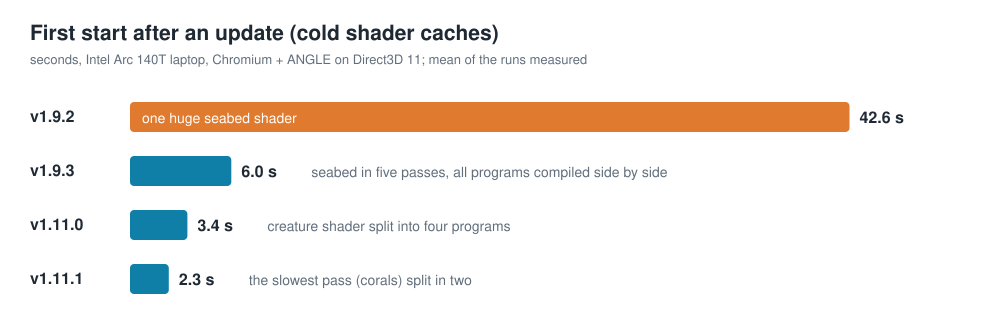
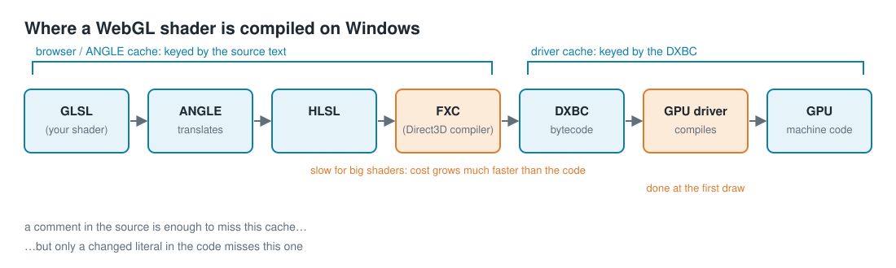
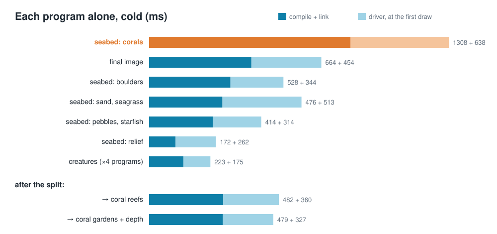

# From 42 seconds to 2: cold-starting a WebGL wallpaper on Windows

[中文版](startup-time.zh-TW.md) · [Shallow Sea](../README.md)

Shallow Sea is a live wallpaper drawn entirely in WebGL2 shaders. After one update it took **about 42 seconds** to show its first frame on an Intel Arc 140T laptop. By the latest version the same cold start takes **about 2.3 seconds**, and the picture is pixel-for-pixel the same. This is how the time was found and removed.



## The symptom

Every launch after an update was slow, and only that one. The second launch was quick (about 0.6 s), because the compiled shaders were cached. The obvious suspect was shader compilation, but "the shaders are slow to compile" is not something you can fix. The question was which shader, which stage, and why.

## Where a shader is compiled on Windows

A WebGL shader goes through more compilers than it looks like:



Chromium hands WebGL to **ANGLE**, which translates GLSL into HLSL. Microsoft's **FXC** compiler turns the HLSL into DXBC bytecode, and the **GPU driver** compiles that into the GPU's own machine code, often only at the first draw. Two caches sit along the way:

- The browser keeps ANGLE's output, keyed by the shader's **source text**.
- The driver keeps its machine code, keyed by the **DXBC**.

FXC is the slow step for big shaders. It unrolls loops and inlines every function, so its cost grows much faster than the size of the code.

## Measuring it honestly

The first numbers were wrong, and it took a while to see why.

To time a cold compile, you have to miss the caches. The usual trick is to add a random comment to each shader, which changes the source text. That defeats the browser's cache, but not the driver's: a comment doesn't change the DXBC, so the driver still finds its cached machine code. In those early measurements a whole ~8 s compile in the driver at the first draw simply never appeared.

The fix is a "deep" nonce: a random literal folded into the shader's output, so the bytecode changes too.

```js
// make every shader cold: a unique, harmless constant added to its output
const r = (1 + Math.random()).toFixed(9) + 'e-30';
src = src.replace(/\}\s*$/, `  o.x += ${r};\n}\n`);
```

Two more rules made the numbers trustworthy:

- **Time from page start to the first frame finishing on the GPU** (a `readPixels` forces it to finish), not just to `linkProgram` returning.
- **Alternate old and new versions** run after run. On a laptop with background load the same build varied by ±0.5 s; only interleaved runs compare fairly.

## The culprit: one huge seabed shader

The seabed (sand ripples, seagrass, boulders, coral reefs, pebbles, starfish) is generated procedurally and baked into a texture once per seabed. It was one fragment shader of a few hundred lines with nested 3×3 cell loops, and on its own it took **25–42 s** in FXC, plus about 8 s in the driver.

Making the loops dynamic (bounded by uniforms, so FXC can't unroll them) helped only a little. What worked was cutting the shader into **passes**: each does one part of the seabed and hands its result to the next through a float texture. A single pass costs 0.3–1.5 s, about 5 s added up, because compile time grows faster than the code does. Since the intermediate textures are float32, the result is the same seabed: comparing the old and new textures, under 0.02% of colour values differed, and only in the last bit.

## A trap: two outputs per draw

The first version of the split let some passes write two textures at once (multiple render targets). It compiled fine, then stalled for **4.7 s** at the first draw. ANGLE on Direct3D 11 builds a program for its first output only at link time, then rebuilds it, synchronously, the first time it is drawn with two targets. Each pass now writes one target and is simply drawn twice when it has two results.

## Compile everything at once

WebGL compiles in the background if you let it. With `KHR_parallel_shader_compile`, the rule is: start every program, and only then ask whether any of them linked.

```js
gl.getExtension('KHR_parallel_shader_compile');
const programs = sources.map(([vs, fs]) => startProgram(vs, fs))   // compile + link, don't wait
                        .map(finishProgram);                        // now check LINK_STATUS
```

Checking `LINK_STATUS` right after each `linkProgram` makes the browser wait for that program alone, so they compile one at a time. Together, the seabed split and parallel compile brought the cold start from about **42 s to about 6 s** (v1.9.3).

## Profile, don't guess

Later features (reef sharks, waves that feel the water depth) pushed the time back up to about 3.4 s. An obvious next target was the creature shader, the longest in the code, so it was split into four programs by group of species (each `#define` picks which creatures a program can draw, and instances are drawn in runs that share a program). That saved less than a second.

Before guessing again, every program was timed **on its own**, cold. The browser's WebGL calls were wrapped before the wallpaper loaded, to capture each program's sources. Each program was then recompiled alone with a fresh deep nonce and drawn once into an 8×8 target:



Two things stood out:

1. **The coral pass was the critical path.** At 1.3 s plus 0.6 s in the driver, it was twice as slow as anything else. The creature programs, the earlier target, were only about 0.2 s each.
2. **The browser compiled only about two programs at a time.** Fourteen programs added up to about 4.5 s of work and took 2.05 s of wall time, so only cutting real work or shortening the slowest program would help.

Splitting the coral pass into "reefs" and "coral gardens plus water depth" did both. Each half takes about 0.5 s, together less work than the one was, and the slowest program is now the final image at about 0.65 s. The seabed's colour and depth came out identical to the last bit on every seabed tested. The cold start went from **3.4 s to 2.3 s** (three alternating runs each: 3.56, 3.00, 3.56 s against 2.28, 1.68, 2.84 s).

## What it adds up to

| Version | Change | First start after an update |
| --- | --- | --- |
| v1.9.2 | one seabed shader | ~42 s |
| v1.9.3 | seabed in five passes, everything compiled in parallel | ~6 s |
| v1.11.0 | creature shader in four programs | ~3.4 s |
| v1.11.1 | the coral pass split in two | ~2.3 s |

Warm starts went from 0.9 s to 0.6 s along the way, and the per-frame cost did not change.

## Lessons

- **Know which caches you are missing.** A benchmark that only defeats the browser's cache leaves the driver compile hidden.
- **Split by cost, not by line count.** On this compiler a shader twice as long can take far more than twice as long, so cutting the biggest shader in half also cuts the total work.
- **Time each piece before optimising the obvious one.** The longest source file was not the slowest program.
- **Prove the output is unchanged.** Every split was checked against the previous build pixel by pixel, so the speed-up is not a quality trade-off.

The code is in [`src/gl.js`](../src/gl.js) (parallel compile), [`src/shaders/seabed.js`](../src/shaders/seabed.js) (the six passes) and [`src/targets.js`](../src/targets.js) (how they are chained).
