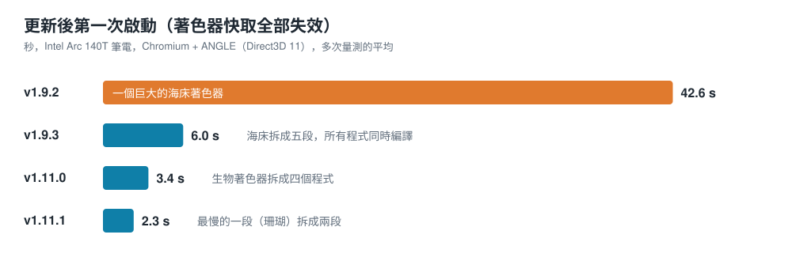
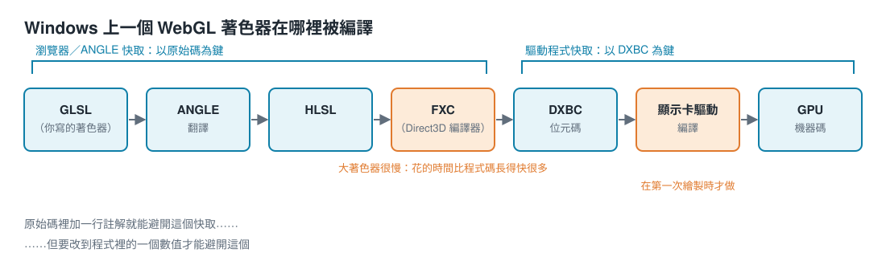
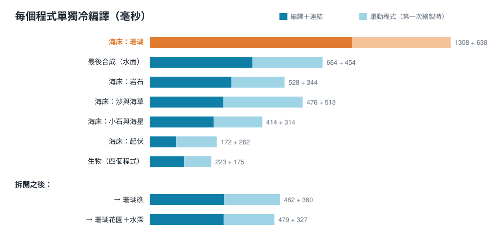

# 從 42 秒到 2 秒：在 Windows 上讓 WebGL 桌布快速冷啟動

[English](startup-time.md) · [Shallow Sea](../README.md)

Shallow Sea 是一個完全用 WebGL2 著色器畫出來的動態桌布。曾經有一個版本，更新後在 Intel Arc 140T 筆電上要 **約 42 秒** 才出現第一個畫面。到最新版本，同樣的冷啟動只要 **約 2.3 秒**，而且畫面逐像素完全一樣。這篇記錄時間花在哪裡，以及怎麼把它省下來。



## 症狀

每次更新後的第一次啟動都很慢，而且只有那一次。第二次啟動很快（約 0.6 秒），因為編譯好的著色器已經被快取起來。最可疑的當然是著色器編譯，但「著色器編譯很慢」不是一個能直接解決的問題。真正要回答的是：哪一個著色器、哪一個階段、為什麼慢。

## Windows 上著色器在哪裡被編譯

一個 WebGL 著色器經過的編譯器，比表面上看起來多：



Chromium 把 WebGL 交給 **ANGLE**，ANGLE 把 GLSL 翻譯成 HLSL；微軟的 **FXC** 編譯器把 HLSL 編成 DXBC 位元碼；最後**顯示卡驅動程式**再把它編成 GPU 自己的機器碼，而且常常要等到第一次繪製時才做。這條路上有兩個快取：

- 瀏覽器保存 ANGLE 的輸出，以著色器的**原始碼文字**為鍵。
- 驅動程式保存它的機器碼，以 **DXBC** 為鍵。

對大型著色器來說，FXC 是最慢的一步。它會展開迴圈、把每個函式都內聯進來，所以花的時間比程式碼長度增加得快很多。

## 誠實地量測

一開始量到的數字是錯的，花了一段時間才知道原因。

要量冷編譯，就得避開快取。常見的做法是在每個著色器裡加一行隨機註解，讓原始碼文字不同。這能避開瀏覽器的快取，卻避不開驅動程式的：註解不會改變 DXBC，驅動程式照樣找得到快取的機器碼。所以早期的量測裡，驅動程式在第一次繪製時那約 8 秒的編譯，完全沒有被算進去。

解法是「深層」的隨機值：把一個隨機常數折進著色器的輸出裡，讓位元碼也跟著改變。

```js
// 讓每個著色器都是冷的：在輸出加上一個獨一無二、不影響畫面的常數
const r = (1 + Math.random()).toFixed(9) + 'e-30';
src = src.replace(/\}\s*$/, `  o.x += ${r};\n}\n`);
```

另外兩個原則讓數字可信：

- **從網頁開始量到第一個畫面在 GPU 上真正畫完**（用 `readPixels` 強制它完成），而不是量到 `linkProgram` 回傳為止。
- **舊版和新版輪流跑**。筆電有背景負載時，同一個版本每次會差到 ±0.5 秒，只有交替量測才能公平比較。

## 元凶：一個巨大的海床著色器

海床（沙紋、海草、岩石、珊瑚礁、小石頭、海星）是程序化產生的，每片海床只畫一次存成貼圖。原本它是一個幾百行、帶有巢狀 3×3 格子迴圈的片段著色器，單獨在 FXC 裡就要 **25～42 秒**，驅動程式還要再花約 8 秒。

把迴圈改成動態的（用 uniform 決定上限，讓 FXC 無法展開）只有一點點幫助。真正有效的是把著色器拆成**多個階段（pass）**：每一段只畫海床的一部分，再透過浮點貼圖把結果交給下一段。單一段只要 0.3～1.5 秒，加起來約 5 秒，因為編譯時間增加得比程式碼快。中間貼圖用 float32，所以結果是同一片海床：比對新舊貼圖，不到 0.02% 的顏色值有差，而且只差在最後一個位元。

## 一個陷阱：一次畫兩個輸出

第一版拆分讓某些階段一次寫兩張貼圖（multiple render targets）。編譯沒問題，但第一次繪製時卡了 **4.7 秒**。原因是 Direct3D 11 上的 ANGLE 在連結時只為第一個輸出建立程式，第一次用兩個輸出繪製時，才同步地重新建立一次。現在每個階段都只寫一張貼圖，有兩個結果的就畫兩次。

## 一次編譯全部

只要允許，WebGL 會在背景編譯。有了 `KHR_parallel_shader_compile`，原則是：先開始所有程式，最後才問它們有沒有連結成功。

```js
gl.getExtension('KHR_parallel_shader_compile');
const programs = sources.map(([vs, fs]) => startProgram(vs, fs))   // 編譯＋連結，不等待
                        .map(finishProgram);                        // 這時才檢查 LINK_STATUS
```

如果每次 `linkProgram` 之後馬上檢查 `LINK_STATUS`，瀏覽器就得單獨等那一個程式，變成一個一個編譯。拆分海床加上平行編譯，讓冷啟動從 **約 42 秒降到約 6 秒**（v1.9.3）。

## 先量清楚，不要用猜的

後來加的功能（礁鯊、會感受水深的浪）又把時間推回約 3.4 秒。看起來最該拆的是生物著色器，它是程式裡最長的一個，所以按生物種類拆成四個程式：每個用 `#define` 決定能畫哪些生物，繪製時把共用同一個程式的連續實例一起畫。結果省不到一秒。

這次在下一步之前，先把每個程式**單獨**冷編譯量一遍。在桌布載入前包住瀏覽器的 WebGL 呼叫，記下每個程式的原始碼；然後一次只重新編譯一個（每次用新的深層隨機值），並在 8×8 的貼圖上畫一次：



有兩件事很明顯：

1. **珊瑚那一段是關鍵路徑。** 1.3 秒再加驅動程式 0.6 秒，比其他任何一個慢一倍。先前被當成目標的生物程式，每個其實只要約 0.2 秒。
2. **瀏覽器一次大約只同時編譯兩個程式。** 14 個程式加起來約 4.5 秒的工作量，實際花了 2.05 秒。所以只有減少真正的工作量、或縮短最慢的那個才有用。

把珊瑚那一段拆成「珊瑚礁」和「珊瑚花園＋水深」，兩件事一次做到：每半段約 0.5 秒，加起來的工作量比原本少，現在最慢的變成畫最後畫面的程式，約 0.65 秒。測過的每一片海床，顏色和水深都跟原本一模一樣。冷啟動從 **3.4 秒降到 2.3 秒**（新舊各交替跑三次：3.56、3.00、3.56 秒對 2.28、1.68、2.84 秒）。

## 總結

| 版本 | 改了什麼 | 更新後第一次啟動 |
| --- | --- | --- |
| v1.9.2 | 一個海床著色器 | 約 42 秒 |
| v1.9.3 | 海床拆成五段，全部平行編譯 | 約 6 秒 |
| v1.11.0 | 生物著色器拆成四個程式 | 約 3.4 秒 |
| v1.11.1 | 珊瑚那一段再拆成兩段 | 約 2.3 秒 |

一路下來，有快取時的啟動從 0.9 秒變成 0.6 秒，每一幀的效能則沒有改變。

## 學到的事

- **弄清楚自己避開了哪些快取。** 只避開瀏覽器快取的量測，會把驅動程式的編譯藏起來。
- **按成本拆，不是按行數拆。** 在這個編譯器上，兩倍長的著色器可能要花遠超過兩倍的時間，所以把最大的那個切半，總工作量也會跟著減少。
- **先逐一量測，再決定優化哪裡。** 最長的原始檔不是最慢的程式。
- **證明輸出沒有改變。** 每次拆分都和前一版逐像素比對，所以速度不是拿畫質換來的。

程式碼在 [`src/gl.js`](../src/gl.js)（平行編譯）、[`src/shaders/seabed.js`](../src/shaders/seabed.js)（六個階段）和 [`src/targets.js`](../src/targets.js)（它們怎麼串起來）。
